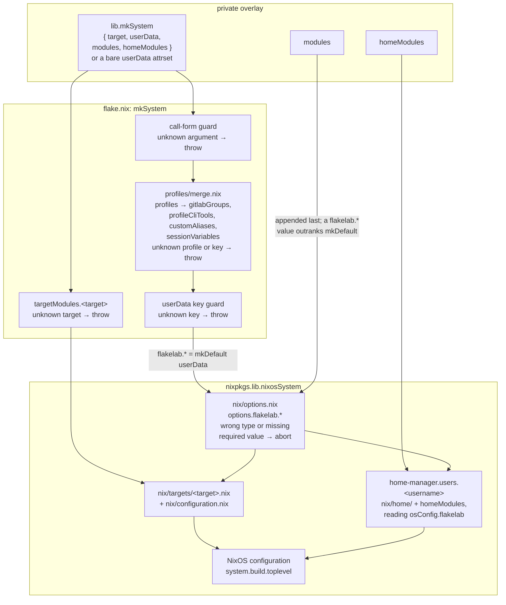
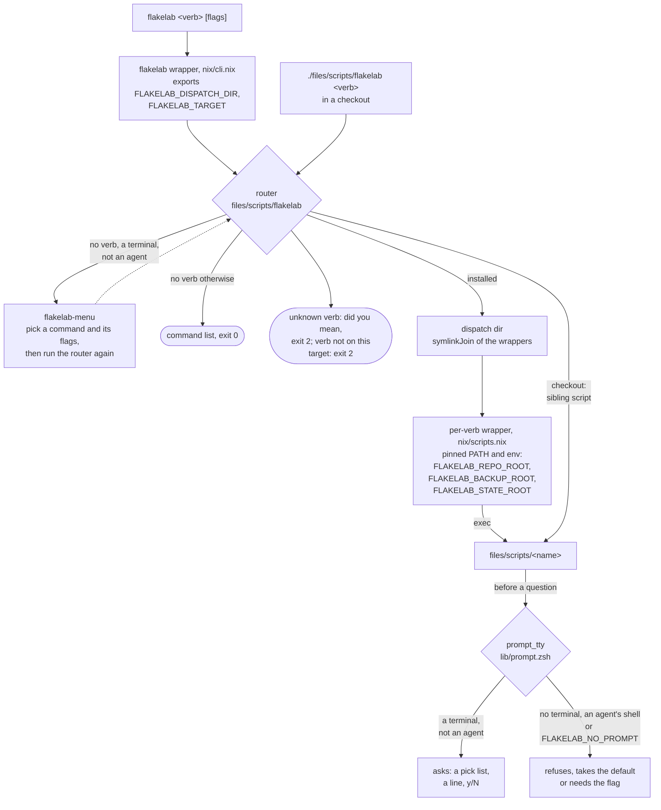
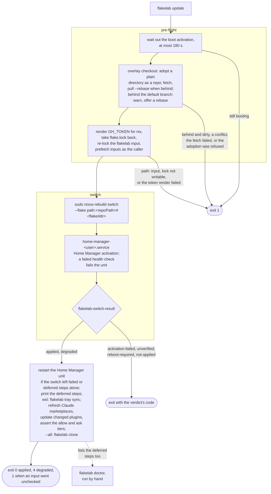
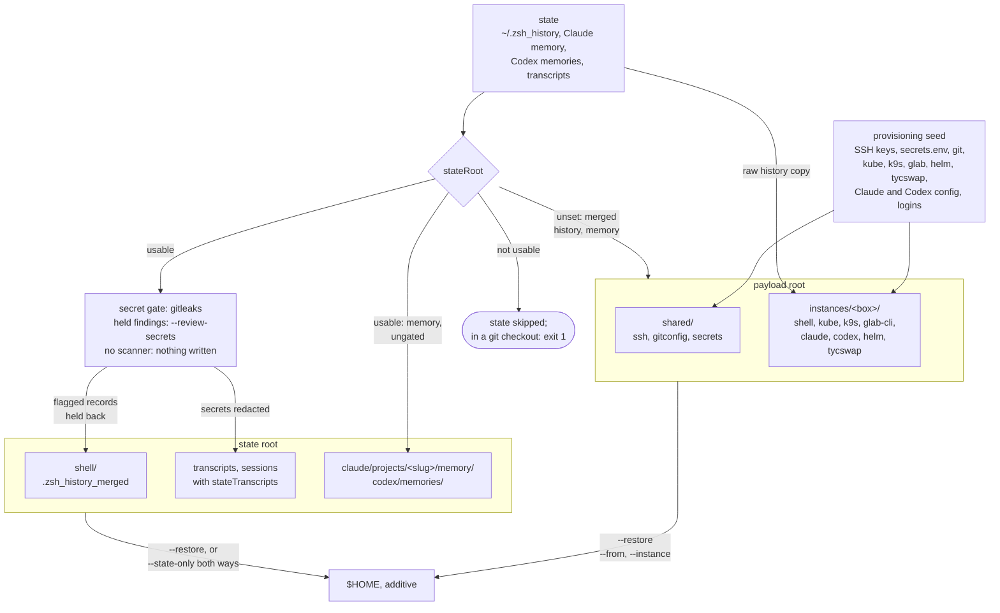

# Architecture

Why flakelab is put together the way it is. Usage lives in
[`README.md`](README.md); hazards in [`known-issues.md`](known-issues.md); the
options, with types, defaults and descriptions, in `nix/options.nix`.

## Principles

1. **Two layers.** System-scoped configuration in `nix/configuration.nix` plus
   the one platform module `mkSystem` picks from `nix/targets/`; user-scoped in
   `nix/home/` (Home Manager as a NixOS module), one module per concern.
2. **Declarative first.** The only imperative exceptions are foreign binaries
   whose nixpkgs builds lag upstream (Claude Code, Codex) and SSH key
   material — both behind guarded, idempotent activation, never in the store.
3. **Per-user values are data.** `nix/users/default.nix` holds placeholders; real
   values are injected by the private overlay through `lib.mkSystem`. Flakes
   evaluate only git-tracked files, which is what keeps a public fork free of
   personal data.
4. **Secrets never enter repo or store in plaintext.** They come from exactly
   one source, chosen at build time by `sopsSecretsFile`: the overlay's
   age-encrypted sops dotenv file, decrypted by sops-nix into the `/run/secrets`
   ramfs, or, without it, `~/.config/flakelab/secrets.env` from a vault. There
   is no runtime fallback between the two, so an enrolled box with no render
   starts with no secrets rather than a stale file (`nix/secrets.nix`,
   `nix/home/zsh.nix`).

## Options and the overlay

`nix/options.nix` declares every per-user value once, so a typo or a wrong type
aborts evaluation. Options **without** a default (`username`, `repoPath` among
them) must keep aborting when unset rather than defaulting.

`lib.mkSystem` has two call forms. The attrset form takes the declared keys
directly; the second form, `{ userData, modules, homeModules }`, lets an overlay
add arbitrary NixOS or Home Manager modules, so an overlay never has to fork
this repo. A `modules` entry may also set any `flakelab.*` option and outranks
the attrset (which is applied with `mkDefault`): scalars and lists are replaced,
while `sessionVariables`, `customAliases` and `claudeMcpServers` merge per key —
replacing one of those wholesale needs `lib.mkForce`.

Anything that describes the **operator** rather than the distro is an option
that defaults to off, because every activation here runs on every adopter's box:

- `claudeAgentDefaults` and `claudeRemoteControl` each trade something of the
  operator's away — the permission prompts, or the transcript staying on the
  box — and the trade is the adopter's to make, one switch at a time: neither
  option implies the other. Everything else `claudeSettings` asserts is
  unconditional, and the whole activation is gated on `installClaude`.
- `notify.*`, `mosh.enable` and `web.*` reach outside the box — a push, an open
  port, a dashboard — so each is its own switch. ttyd is reached only through
  the dashboard, never on a port of its own.
- `mcpShared.*` and `mcpBrowsers.headless` register their servers in Claude and
  Codex from one definition (`mcp.md`), so the two clients cannot drift.
- `claudeMdExtra` keeps the shipped half of `~/.claude/CLAUDE.md` and
  `~/.codex/AGENTS.md` limited to facts about the distro; personal workflow
  rules go there, from the overlay, and reach both agents.
- `bitwardenServer = null` skips the `bw config server` activation entirely
  rather than rewriting someone's region on every rebuild.

`profiles/` is resolved **before** the module system runs: `profiles/merge.nix`
turns the selected `profiles` into effective `gitlabGroups`, `profileCliTools`,
`customAliases` and `sessionVariables`, which is why `profiles` itself is not an
option. The registry is the directory, so a new profile is one new file; a
profile key `merge.nix` does not read, or a tool that resolves to no package,
aborts evaluation by name.

From the overlay's call to a built system, with the point where each guard
aborts and where the escape hatch enters:

Generating the overlay is one script with two call sites, because it reads
`templates/overlay/` and `profiles/` relative to itself. From a **checkout**
(`./files/scripts/nix-overlay-generate`) `--flakelab-ref` defaults to `path:`
that checkout. From **PATH** (`flakelab overlay-gen`) it reads a store path and
`--flakelab-ref` is **required**: the only default would be a
garbage-collectable store path, and an overlay pinned to it breaks at the next
GC. Git-ignore the overlay's own `flake.lock`: a committed lock pins the NAR
hash of a local checkout, and the next edit there aborts the build with "NAR
hash mismatch".

## Targets

`target` picks the platform module `mkSystem` builds from, unioned with the
shared `nix/configuration.nix`. It is a `let`-level choice, not a module-system
one: `imports` cannot be `mkIf`'d, so the module list is decided before a module
system exists. `nix/options.nix` still declares `flakelab.target` — `readOnly`,
no default — purely so the choice is inspectable afterwards; nothing but
`mkSystem` may set it. `flakeAttr` is its companion: an overlay describing more
than one box gives each `nixosConfigurations.<name>` the matching `flakeAttr`,
so each box's `flakelab update` switches into itself.

The seed image is a **variant** of `nixosConfigurations.proxmox-vm`, not a
second system (`image.modules.proxmox-vm-seed`). The variant forces
`home-manager.users` empty and parks the placeholder user's uid at 65000. Both
are load-bearing: a full closure is far past what a release asset carries, and a
Home Manager activation in a generic image would run installers against
credentials it cannot have; with the placeholder out of the useradd range, the
login cloud-init creates lands on uid 1000, the uid the overlay declares for it.
`checks.targets` asserts the stripping held.

A seed is half a system, and the other half is private. `flakelab-bootstrap` is
the seam: a one-shot unit that reads `/etc/flakelab/bootstrap.env`. `OVERLAY_URL`
defaults to the `overlayUrl` of the overlay the seed was built from and is
required only without it.

- It clones, locks and checks out the overlay **as `BOOTSTRAP_USER`** — a lock
  written by root makes that user's next `nix` command in the checkout fail —
  and runs only the `nixos-rebuild switch` as root.
- Its marker follows the switch's verdict (see "A switch's result"): `applied`
  and `degraded` write it, since a further run would only switch into the same
  generation again; every other verdict writes nothing and the next boot retries.
  The verdict comes from the seed's own `flakelab-switch-result`, so an overlay
  pinning an older flakelab is still classified.
- An identity `BOOTSTRAP_USER` cannot read exits 75 and names the path, because
  on a fresh guest the key arrives after the first boot and the unit is meant to
  be started again.
- The unit ships from the target module, not the seed variant: the marker is
  what makes it a one-shot, never the image.

The wsl target also decides where systemd starts: its `flakelab-wsl-init-cgroup`
activation snippet moves a distro that starts in a cgroup its users cannot enter
before systemd roots its tree there (known-issues.md, "No user manager").

## The CLI

`flakelab` is one binary with subcommands, and it is a **router**
(`files/scripts/flakelab`): each subcommand execs the per-command wrapper
`nix/scripts.nix` builds, so every one keeps its own pinned PATH and exported
environment. `FLAKELAB_REPO_ROOT` is what makes `build-distro` and
`test-provision` callable from anywhere: deriving the repo root from `$0` yields
a store path once they are packaged. Run from a checkout, the router dispatches
to the sibling `files/scripts/<name>` copies.

`gitchecker`, `gitcleaner` and `gitpublisher` stay standalone commands — no
namespace collision, and other repos invoke them by name.

### At a terminal

A person gets questions where an agent gets flags. Every prompt lives in
`files/scripts/lib/prompt.zsh` and is gated on `prompt_tty`: stdin and stderr a
terminal, `TERM` not dumb, no `FLAKELAB_NO_PROMPT`, and not an agent's own shell
(`CLAUDECODE` or `CODEX_THREAD_ID` set, since Codex can give a command a pty).
Anywhere else a command does what it did before it could ask — refuse, take the
default, need the flag — so an agent's shell, a pipe, a hook, a timer and every
`--json` run meet no prompt and wait on none.

A bare `flakelab` at a terminal opens `flakelab-menu`, which re-enters the
router with the chosen flags, so the target gate and the command's wrapper apply
as they do to a typed command. The menu asks nothing a command asks itself: a
command missing a required argument asks for it and prints the full command it
amounts to, so the flags are there to copy next time.

## Why two switches

A `provision` applies the overlay twice. The SSH-dependent activation steps —
plugin clones, the marketplaces, the statusline that follows them — need a
passphrase-unlocked ssh-agent, and the key can only be copied into `~` once the
Linux user exists, which is what the first switch creates. So the order is
switch #1 -> seed key and `secrets.env` -> load the agent -> switch #2, which
completes what #1 could only defer.

Switch #2 is **conditional on that agent load succeeding**: with no private key
in the payload there is nothing to load, and a second switch could only defer
again. A one-switch run ends with no plugins and no statusline until a
`flakelab update` from inside the distro with an agent holding a key;
`flakelab doctor` is the only hint.

The clone at the end of a `provision` needs the same agent, and WSL can stop the
distro between two `wsl.exe` calls even with the user lingering, which takes the
agent and its unlocked key with it. So the run keeps a hidden `wsl.exe` running
`sleep` in the distro across the key load and the start of the clone, and loads
the key again once the distro has finished booting. A key that does not load is
a warning and the clone still runs: an unencrypted key needs no agent, and an
encrypted one makes the clone refuse with its own message.

Both switches wipe VM-wide WSL interop, so each is followed by an interop probe
and an offer to `wsl --shutdown`. A non-interactive run never shuts anything
down by itself.

## A switch's result

`nixos-rebuild switch` exits with switch-to-configuration's status, and that
status cannot say what happened: it is 2 when the activation script failed and 4
when a unit did, and a unit failing after a failed activation script overwrites
the 2 with the 4. The activation a boot runs has no status at all.

So the verdict is read from the system instead. The
`flakelab-activation-result` activation snippet is ordered after every other
snippet and records the activation script's own status, the system it activated
and the init it ran under, in `/run/flakelab/activation` — at every switch and
every boot. `flakelab-switch-result` combines that record with systemd's failed
units, the running user managers' included, and prints one verdict. Its header
is the contract for the verdicts and their exit codes.

Every caller applies the same rule: `applied` and `degraded` carry on,
`degraded` ending the run with exit 4 and the units named; every other verdict
stops with its own code. Three points constrain a change here:

- `degraded` names every unit not running when it reads, not only the switch's
  own, and counts a service crash-looping in auto-restart as failed, as
  switch-to-configuration does, though `systemctl --failed` never lists it.
- Across a switch a caller carries the units a degraded verdict named: a switch
  resets failed units without starting them all, so "not active" rather than
  "failed" is what keeps such a unit named. Across a restart it carries nothing.
- A classifier that runs and answers nothing is never a clean verdict. A running
  system built before the recorder existed is `unrecorded`: only an exit 0 or 2
  is taken from the switch, since a 4 cannot be told from a failed activation.

`flakelab update` (`files/scripts/nix-update`) from its pre-flight to its exit
status, with every point where it stops:

## Activation and the health check

Activation ends in a health check that fails the rebuild on anything a step
reported as a defect, while work it structurally cannot do — no seeded SSH key,
no unlocked ssh-agent, no network — is recorded as **deferred** and never fatal.
That is what lets the first rebuild of a fresh distro succeed before anything
has been seeded into `~`. `flakelab doctor` covers the rest, because it runs
from an interactive shell.

Claude Code state is owned by idempotent jq/marker merges rather than store
symlinks, because Claude rewrites these files itself:

- **`settings.json`** — one pass in `nix/home/claude.nix` asserts attribution,
  the update channel and `installMethod`, the cleanup period, the plugin
  environment, the classifier rules (`claudeAutoMode`), the `permissions.deny`
  **floor**, `deniedMcpServers`, the optional output style, auto-memory
  directory, agent defaults and Remote Control, the `SessionEnd` and
  `Notification` hooks, and the statusline. The floor holds only
  `git push --mirror`: `AUTO-MODE.md` covers how the floor, the ask tier, the
  allowlist and the classifier are ordered, and why the floor is almost empty.
- **`~/.claude.json`** — user-scope MCP servers from `claudeMcpServers`,
  installed mode 600, since the same file holds Claude's account and OAuth
  state.
- **`permissions.allow`** and **`permissions.ask`** — asserted by
  `flakelab update` after every switch from the first declared marketplace that
  ships the tier files. Not an activation: the clone is runtime data, and
  activation reruns only when the built config changed. A marketplace added by
  hand is never read, and an allow file that approves a whole command, write or
  fetch tool is refused.
- **Installed plugins** — activation uninstalls an `mcp-*` plugin the list
  stopped naming and a plugin it does not name that a declared marketplace no
  longer offers. A missing or empty catalogue prunes nothing and says so.
- **`CLAUDE.md`** — a `<!-- BEGIN managed by flakelab -->` block; anything
  outside the markers is left alone. Codex's `~/.codex/AGENTS.md` gets the same
  block without the permission tiers and the question-tool text, which reach
  Codex through `developer_instructions`. An `AGENTS.override.md` beside it
  makes Codex skip the block, and a `home.file` for the path is refused at
  evaluation.

A merge takes back what it stops rendering, and nothing else. The `env` of
`settings.json` and the `mcpServers` of `~/.claude.json` are maps the user and
the tool write too, so each merge records the key names it wrote, never their
values, in `~/.local/state/flakelab/activation-rendered/`. A name in that record
that the next generation no longer renders is removed; a name never recorded
stays, and a missing or unreadable record removes nothing. The record is
rewritten only after the file was, so a failed merge leaves it for the next one.

`~/.gitconfig` is a flake-owned `[include]` of `~/.config/git/config`. git reads
the legacy path last, so a real file there would override every key
`programs.git` sets. The trade: `git config --global` now writes to the
read-only store and fails; git config is declarative here.

## Backup, and what a payload is

`flakelab backup` writes two different kinds of thing, which want opposite
treatment:

- The **provisioning seed** — secrets, keys, tool config, logins — describes
  _this_ host and must never leave the overlay checkout.
- The **state** — merged shell history, agent memory, optionally session
  transcripts — is what you want on every machine you work from.

`stateRoot` splits them: set it and the state is written there instead of into
the payload. What replicates that directory is outside this repo's knowledge,
with one exception: `stateSyncthing` runs Syncthing on the box with the state
root as its only folder, shared with a hub that holds it Receive Encrypted, so
the hub and its disk only ever see ciphertext. An optional `trustedHub` gets the
folder without the password: a plaintext replica for processing.

A box that leaves `stateTranscripts` off does not take the transcript trees from
the folder either: syncthing-init writes a `.stignore` for them. Ignoring a path
leaves on disk what an earlier sync put there (`known-issues.md`).

The daily timer only PUSHES into the state root; two-way convergence needs
`stateSyncInterval` (`--state-only`, which pushes AND pulls). The two timers are
independent, so a box that must not run the unattended daily payload pass still
converges its state root. Memory is keyed by the checkout's **absolute path**,
so keep checkouts at the same path on both boxes — and never let a checkout live
inside the synced folder.

The restore is additive. The backup mirrors a box's own categories instead: a
file deleted at home leaves the payload on the next run, while `shared/ssh`,
which several boxes write into, stays additive. Rollback snapshots cover the
payload only: every write into the state root is additive or a union, and the
sync client's own version history is the rollback there.

### Shared state and the secret gate

There is no cross-machine lock — the `.backup.lock` beside the payload
serialises runs on one box and is invisible to the other — so every write into
the state root has to converge on its own:

- **History** is a union: additive, deduplicating and stability-checked.
- **Conflict copies** (every sync client has its own spelling) are handled by
  kind: a conflict copy of one of the three files both machines rewrite — the
  merged history, the shared `MEMORY.md` index and the gate's `decisions.jsonl`
  — is merged in and then removed; every other conflict copy, and the metadata
  litter, is ignored on restore and never copied into `$HOME`.
- **Memory** is additive and newest-wins: a topic file the destination changed
  since the last sync is kept. `MEMORY.md` merges one line per memory file.
  Deletions propagate through tombstones: a box records the topic files it holds
  after each pull, so a file it then lacks while the state root still has it was
  deleted there. A copy edited after the deletion lifts the tombstone. A
  directory with nothing left in it is treated as a reset: nothing propagates
  and the pull refills it.
- **Transcripts** are opt-in and grow-only in both directions: a copy with
  fewer lines never overwrites one with more, `--force` included. Lines, not
  bytes — a redacted copy can outweigh its source. A longer copy that does not
  _continue_ the one it would replace is a fork, the same session carried on in
  two places: the longer copy takes the path and the other branch is parked
  first, a state-root copy under `<stateRoot>/claude/diverged/`, a local one
  raw on its own box. Nothing prunes parked branches. Missing local sessions are
  pulled only within the cleanup window, measured from the last timestamp in the
  transcript; unknown ages stay eligible.
- **Session side files** travel with the transcripts, write-once, through the
  same gate; a file whose secret cannot be matched literally stays on its box.
- **Codex** follows the same two rules, with two differences. Its memories sync
  without an index merge, since Codex regenerates every file there and the
  newest copy wins whole. A rollout line carries no id, so the fork check
  matches the timestamp the shorter copy ends on. With `codexCleanupPeriodDays`
  a deleted rollout stays gone only when every box sharing the state root sets
  the option: a box left at the default pulls old rollouts back, and its push
  re-creates copies pruned from the state root.

**The gate.** The merged history and the transcripts are everything ever typed
at a prompt or printed in a session, including anything pasted before you had a
vault; whatever replicates that folder keeps version history of it. So every
backup scans what it is about to write into the state root with `gitleaks` and
holds findings back:

- A flagged **history** record is held back whole; the rest of the merge still
  goes.
- A flagged **transcript** is copied with the secret replaced by
  `[REDACTED:<rule>]`; only a file that cannot be cleared is held back whole.
- **Local files are never modified by a backup** — the gate decides what is
  written out, not what you keep.
- **Memory is not gated**: it is small, curated and hand-written. History is
  none of those, which is the point.

A run with held findings warns rather than fails. `flakelab backup
--review-secrets` walks them one at a time: **delete** from every local source,
**keep** it local and never sync it, or **allow** it. Decisions are stored in
the state root as fingerprints, never secrets, so one triage settles a secret
for every machine's _syncing_ — but a **delete** rewrites local files, and only
the box you are sitting at may do that, so it stays pending elsewhere until that
box runs its own review. The review needs a terminal and refuses `--dry-run`,
because it is the one mode that rewrites local files. Before a delete rewrites a
file it keeps a pre-scrub copy, and a copy that cannot be made refuses the
rewrite; the copy holds exactly what the delete removed, so later runs remove it
after a week.

A fingerprint is a plain `sha256`, not an HMAC, and it lives in a folder
something replicates: a low-entropy secret — a short password, a PIN, a token
from a small keyspace — can be recovered from it by guessing offline. Treat the
decisions file as sensitive. If the scanner is missing from PATH the run records
a failure and writes neither category: nothing ungated reaches the state root.

Two refusals are built in: a `stateRoot` that is, or sits inside, a git checkout
is rejected outright (sync clients write conflict copies of `.git/config`,
`index` and `packed-refs` — a corrupted repository, not a merge), and a root
whose parent directory is missing (the sync drive is not mounted) skips the
state categories with a recorded failure rather than silently writing them
somewhere else. On a Windows drive POSIX modes are lost — one more reason the
seed stays out.

## Language runtimes

`python3` is there for `#!/usr/bin/env python3` scripts, the Claude
marketplace's PreToolUse guard hooks among them. It carries one library, PyYAML,
because agents read YAML with `python3 -c 'import yaml'`, and it is installed at
low priority so an overlay's own `python3` replaces it instead of colliding.
There is deliberately **no `pip`**: `uv` is the installer for Python tooling.
